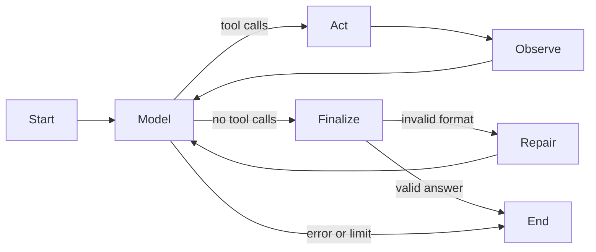

# CedarBridge C4

Custom ReAct agents with configurable personas for EECE 503P/798S, Fall 2026.

This extends the [C3 business assistant](https://github.com/Jiany-S/C3). Mira helps students choose coaching; Sami reviews project blockers and preparation needs. Both use the same CedarBridge business sources and tools. A manually written LangGraph loop handles model decisions, actions, observations, and final-answer parsing.

Start with [the executed notebook](react_agent.ipynb). It includes the implementation walkthrough, experiment results, and all five reflection answers. For a quick review, open sections 2–4 for personas and the manual loop, section 8 for the comparisons, and section 12 for the reflection.

## Run locally

Use Python 3.11 or later. From this project folder in PowerShell:

```powershell
python -m venv .venv
.\.venv\Scripts\python.exe -m pip install -r requirements-dev.txt
Copy-Item .env.example .env
```

Add your own OpenAI API key to `.env`, then run:

```powershell
.\.venv\Scripts\python.exe app.py
```

Open `http://127.0.0.1:7861`. Choose an advisor, send a message, and expand **Actions and observations** to inspect the actual result. Switching advisors clears the conversation and restores that persona's settings. Advanced controls let you change temperature, top-p, penalties, token limit, examples, the step-by-step prompt, and instruction placement.

Try: “Compare Team Sprint with Prototype Clinic for five students, then quote two Team Sprint sessions.” The final estimate should be USD 240 with a matching calculation observation. For a follow-up, use a fictional name and `example.com` address.

Each live turn uses the paid OpenAI API. The default model is `gpt-4.1-mini`; the app accepts an `OPENAI_MODEL` override for a model supporting these parameters and tools. Secrets and runtime logs are ignored by Git.

## What changed from C3

- The C3 router/handler loop is replaced by explicit LangGraph model, action, observation, finalization, and format-repair nodes.
- Two agents have different roles, prompt traits, and generation settings: Mira uses temperature 0.6 and presence penalty 0.2; Sami uses temperature 0.1 and zero penalties. Both use top-p 1 and a 650-token completion limit.
- Service lookup and quote calculation extend the original lead and feedback tools.
- Controlled experiments compare persona bundles, prompt methods, instruction placement, and generation parameters. Reflection here means the written analysis required by C4; there is no separate post-answer reviewer in the live loop.



No prebuilt agent executor, ToolNode, or agent factory is used. Model calls use the OpenAI SDK directly; LangGraph controls the transitions. [Tool contracts](docs/tools.md) describe validation and observations.

## Verification and experiments

```powershell
.\.venv\Scripts\python.exe -m pytest tests -q
.\.venv\Scripts\python.exe scripts/execute_notebook.py
.\.venv\Scripts\python.exe scripts/smoke_gradio.py
.\.venv\Scripts\python.exe scripts/verify_evidence.py
```

The automated suite has 36 passing tests. These checks use scripted model outputs and require no API key. Run All in the notebook displays saved real evidence and runs the tests. It does not repeat paid experiments or launch a server unless explicitly enabled with `RUN_LIVE=true` or `RUN_UI=true`.

The final live study contains **192 trials**: 12 setups, 8 scenarios, and 2 repetitions. Both default personas passed 16/16 functional checks. The reduced-instruction condition scored 14/16, zero-shot 15/16, and the short-token condition 15/16. Several configurations tied; the study does not establish a unique best model setup.

- [Experiment results and limitations](docs/experiment_results.md)
- [New-scenario checks](docs/new_scenarios.md): 12 additional live trials with unchanged persona prompts
- [Reflection answers](docs/reflection.md)
- [Requirement mapping and self-assessment](docs/self_assessment.md)
- [Raw final trials](evidence/experiments/trials/) and [comparison CSV](evidence/comparison.csv)

To repeat the full live study with your own key, use a new output folder:

```powershell
.\.venv\Scripts\python.exe experiments.py --output evidence/my_run --repeats 2 --workers 4
```

The runner refuses to overwrite an existing folder and caps each run at 600 API requests. Cases, settings, source snapshots, actual replies, tools, usage, and timing are saved. The earlier run and scoring corrections remain available; failures were not removed. Top-k is unsupported by the selected API and is not sent. CoT-style prompting requests private step-by-step thinking, while only a brief public decision summary is returned and logged.

## Limits

The agent is a classroom prototype. Business facts and prices are fictional. Quotes assume arithmetic grouping at the published unit prices; staff must confirm the feasibility and availability of multiple teams or sessions. A saved lead is only a local follow-up request. The assistant cannot book appointments, send email, take payments, or guarantee grades.

Conversation history is limited to the current session's recent messages. Local JSONL records are single-process storage, and retries across turns can create duplicates. Use fictional contacts: messages are sent to OpenAI, and local traces can contain them. The functional checker covers selected facts and actions, not every sentence or subjective naturalness. There are two repetitions per condition and a small supplementary check on new cases; no independent human preference ratings were collected.
